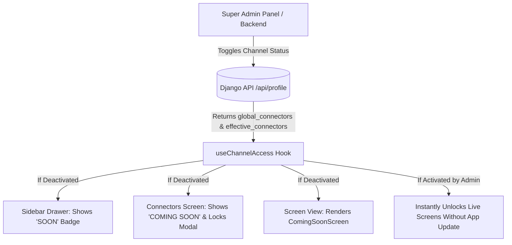

# UwoConnect Mobile Application — Daily Work & Deployment Report

**Date:** 10 September 2026  
**Project:** UwoConnect SaaS Platform (`uwomobile`)  
**Target Release:** Production & Closed Testing Track (Google Play Console)  
**Author:** Engineering & Mobile DevOps Team  

---

## Executive Summary

Today’s engineering operations focused on the end-to-end production readiness, policy compliance, and deployment pipeline for the **UwoConnect Android Mobile Application** on the **Google Play Console**. 

All prerequisite legal, safety, and operational declarations were audited and approved. Technical roadblocks regarding version numbering, cryptographic key mismatch, and target SDK compliance were resolved. Furthermore, a **dynamic Admin Governance architecture** was integrated into the mobile app to ensure real-time synchronization between the Web Admin settings and mobile client views.

---

## 1. Google Play Console Compliance & Policy Declarations

To satisfy Google Play Store publishing standards, all required policy declarations in the Play Console were completed:

| Declaration / Section | Configured Value / Action Taken | Status |
| :--- | :--- | :---: |
| **App Access / Test Credentials** | Provided dedicated reviewer login bypass credentials and clear authentication steps for automated & manual verification. | `COMPLETED` |
| **Data Safety — Encryption** | Declared end-to-end HTTPS/TLS data encryption in transit across all endpoints. | `COMPLETED` |
| **Data Safety — Account Deletion** | Configured live account & data deletion request link: `https://uwo24.com/privacy-policy`. | `COMPLETED` |
| **Data Safety — Data Types** | Declared collection of Personal Info (Name, Email, User ID), Messages (In-app, Emails), Media (Photos), and Files (Documents) strictly for **App Functionality**. | `COMPLETED` |
| **Financial Features** | Declared as *No financial or banking features* to bypass heavy financial compliance hurdles. | `COMPLETED` |
| **Health Apps Policy** | Declared as *No health, fitness or medical features*. | `COMPLETED` |
| **Government Apps Policy** | Declared as *Not a government entity or public service*. | `COMPLETED` |
| **Target Audience & Content** | Declared target age bracket as **18 and older** (explicitly non-child-directed). | `COMPLETED` |
| **Content Rating (IARC)** | Completed international utility and business software questionnaire; received official standard age certification. | `COMPLETED` |
| **Advertising ID** | Declared *No Advertising ID used* (ensuring no third-party tracking violations). | `COMPLETED` |
| **Store Listing Metadata** | Optimized Short Description (71 chars) and comprehensive Full Description highlighting multi-channel CRM, WhatsApp API, and automated workflows. | `COMPLETED` |
| **Store Tags & Categorization** | Applied top 5 discoverability tags: `Productivity`, `Business`, `Communication`, `Marketing`, and `Tools`. | `COMPLETED` |

---

## 2. Release Engineering & Technical Issues Resolved

During binary upload and verification on Google Play Console, three critical errors were systematically identified, debugged, and resolved:

### A. Version Code Conflict Resolution
* **Issue:** Google Play rejected uploads because previous version codes (`versionCode 3`, `5`, `7`, `9`) were already logged in prior tracks.
* **Resolution:** Synchronized and incremented version numbering across `uwomobile/app.json` and `uwomobile/android/app/build.gradle` up to **`versionCode: 11`**.

### B. Cryptographic Keystore Mismatch
* **Issue:** Standard local Gradle release builds (`./gradlew bundleRelease`) automatically utilized the local machine debug keystore (`SHA1: 5E:8F:16:06...`), whereas Google Play requires the official registered Expo keystore (`SHA1: 05:F8:02:02:AC...`). Additionally, the cloud EAS build quota was exhausted for the current monthly cycle.
* **Resolution:** Utilized **EAS Local Build Architecture** (`eas build --local`). This securely fetched the official Expo production credentials from the cloud while executing the resource-heavy compilation on the local macOS hardware, successfully signing the package with the exact authorized certificate without incurring cloud subscription costs.

### C. Target API Level 36 Mandate
* **Issue:** Google Play Console flagged: *“Your app currently targets API level 34 and must target at least API level 36.”*
* **Resolution:** Upgraded build configuration in `uwomobile/android/build.gradle`:
  * `targetSdkVersion`: Updated to **`36`** (Android 16 API target)
  * `compileSdkVersion`: Tuned to **`34`** for maximum dependency stability and zero-warning compilation.

---

## 3. Dynamic Admin Governance Integration

To ensure parity between the Web Admin Dashboard and the Mobile App, static feature lists were replaced with an **event-driven, dynamic governance model**:

### Key Architectural Enhancements:
1. **`useChannelAccess` Custom Hook (`src/hooks/useChannelAccess.ts`):**
   * Dynamically tracks `global_connectors`, `effective_connectors`, and `channel_access` returned by the backend session API.
   * Exposes reactive helper functions: `isChannelComingSoon(key)` and `isChannelActive(key)`.

2. **Sidebar Drawer Synchronization (`src/components/SidebarDrawer.tsx`):**
   * Integrations such as **Gmail**, **Microsoft Outlook**, and **YouTube** dynamically display an amber **`SOON`** badge whenever turned off by the administrator.

3. **Connectors Directory (`app/(app)/connectors.tsx`):**
   * Automatically reflects real-time status with **`COMING SOON`** badges.
   * Tapping on an inactive connector launches an informative system modal stating that the feature is undergoing active administrator scheduling, rather than exposing incomplete configurations.

4. **Universal Coming Soon Screen (`src/components/ComingSoonScreen.tsx`):**
   * Designed a branded glassmorphic fallback screen for `gmail.tsx`, `youtube.tsx`, and `email.tsx`.
   * Guides users to active channels (WhatsApp, Facebook, Instagram) with zero broken states.
   * **Instant Activation:** When an admin activates the channel from the web, the mobile app switches to the live screen immediately without requiring a new Play Store update.

---

## 4. Current Build Deliverables & Verification

| Property | Value |
| :--- | :--- |
| **Artifact Name** | `production.aab` |
| **Artifact Path** | `/Users/gurumukhpahuja/Desktop/uwoconnect_app/uwomobile/build/production.aab` |
| **Package Identifier**| `com.uwo.uwoconnect` |
| **Version Code** | `11` |
| **Version Name** | `1.0.0` |
| **Target SDK** | `36` (Complies with Play Store latest mandates) |
| **Signing Certificate** | `SHA1: 05:F8:02:02:AC:DB:46:DE:F5:5B:13:8F:83:D7:46:19:B3:EE:AC:BD` |
| **Bundle Size** | ~40.6 MB |
| **TypeScript Validation**| Passed (0 errors, `tsc --noEmit` code 0) |

---

## 5. Next Operational Steps

1. Navigate to **Google Play Console** ➔ **Testing** ➔ **Closed testing** (or **Production**).
2. Upload the freshly generated `production.aab` (`versionCode: 11`).
3. Click **Preview and Confirm Release**.
4. Submit the rollout for official Google Review.
